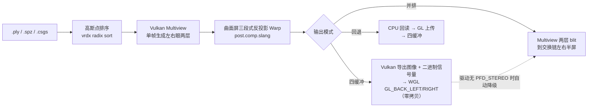

# CurvedStereoGS

**曲面屏立体高斯泼溅渲染系统**（Curved-Screen Stereo Gaussian Splatting Renderer）

CurvedStereoGS 是一个面向曲面显示设备的实时 3D Gaussian Splatting 渲染系统。项目在 NVIDIA Vulkan Gaussian Splatting 示例的基础上，扩展了曲面几何校正、双眼 Multiview 渲染、主动立体输出、跨 API 图像互操作和可观测性工具链。

> **项目亮点**
>
> - **GPU 渲染管线**：Vulkan 1.4 + Slang + Mesh Shader / RTX 路径，支持 `.ply`、`.spz` 和项目文件加载。
> - **动态 4DGS 播放**：读取逐帧高斯位置序列 `.dgs`，在 GPU 上插值后复用现有渲染管线。
> - **训练相机回放**：支持 Dynamic3DGaussians `train_meta.json`，可按训练相机索引显示清晰视角。
> - **曲面屏校正**：通过三段式曲面模型将虚拟平面投影映射到实际曲面屏，并支持宽度、半径、观察距离和分段长度标定。
> - **双目输出兼容性**：Vulkan Multiview 同时生成左右眼图层；根据硬件能力选择 WGL 四缓冲或 Vulkan Half-SBS 回退路径。
> - **工程化工具链**：Qt 6 控制台、`.csgs` 场景项目格式、GPU 能力探测、Benchmark 模式和逐帧 CSV 性能统计。

## 技术指标（能力矩阵）

| 维度 | 实现 |
| --- | --- |
| 图形 API | Vulkan 1.4，OpenGL/WGL 四缓冲互操作 |
| 着色器 | Slang，Vulkan shader 共享头文件 |
| 立体渲染 | Vulkan Multiview，左右眼单帧生成 |
| 输出路径 | WGL Quad-Buffer、Vulkan Half-SBS、自动回退 |
| 场景格式 | PLY、SPZ、CSGS；兼容旧 VKGS 项目；动态位置序列 `.dgs` |
| 控制面板 | Qt 6.5+ Widgets，独立进程管理渲染器 |
| 性能分析 | Benchmark、StereoFrameStats、CSV 帧级采样 |
| 构建系统 | CMake + Visual Studio 2022，依赖与许可证可追溯 |
| 质量保障 | CPU-only 单元测试 + CTest + `.clang-format`，基准结果可归档复现 |

代码结构与帧流程见下文管线图；历次性能优化的背景、思路与实测对比见
[优化记录](docs/optimization-log.md)，动态 4DGS 序列的用法见
[dynamic-4dgs](docs/dynamic-4dgs.md)。基于 NVIDIA 开源 vk_gaussian_splatting（Apache 2.0）
框架的自研边界划分见 [attribution](docs/attribution.md)。

## 渲染与呈现管线



## 项目结构

```text
CurvedStereoGS/
├─ src/                 渲染器 C++ 源码
│  ├─ qt/               Qt 控制台源码
│  └─ shaders/          Slang 着色器与共享头文件
├─ tests/               CPU-only 单元测试（已注册到 CTest）
├─ third_party/         构建所需的第三方源码及各自许可证
├─ cmake/               CMake 查找模块
├─ docs/                优化记录、动态 4DGS 与面试问答文档
├─ tools/               基准采集/分析、动态序列导出与打包脚本
├─ models/              本地场景目录（大型模型不上传）
│  ├─ static/           静态场景（.ply/.spz/.csgs）
│  └─ dynamic/          动态场景（canonical .ply + 同名 .dgs + training_cameras/）
├─ assets/              动态 4DGS 序列资产（本地生成，不入库）
├─ .clang-format        统一代码风格
├─ CMakeLists.txt       项目构建入口
└─ CMakePresets.json    Windows 标准化配置入口
```

第三方依赖的来源和版本见 [third_party/README.md](third_party/README.md)。Qt 控制台启动后自行选择场景与输出模式，参数在“应用并重启”时生效。

## 渲染模式

渲染方式与立体模式是两个独立开关，可组合出四种形态；在 Qt 控制台中通过“渲染方式”与“立体模式”切换，命令行对应 `--curvedScreenWarp 1|0` 与 `--stereo 1|0`：

| | 立体（默认） | 非立体 |
| --- | --- | --- |
| **曲面（默认）** | 三段式曲面立体：Multiview 双眼 + 曲面 Warp + 四缓冲/并排输出 | 曲面 Warp 单目，普通 Vulkan 窗口显示 |
| **平面** | 平面立体：双眼标准透视，四缓冲/并排输出 | 普通平面渲染：单目标准透视，普通窗口显示 |

曲面/平面模式和输出设备参数在启动或“应用并重启”时生效。运行中按 `0` 可即时在立体与单目之间切换；渲染器会重建对应的 viewport 图像和管线，不需要重新启动。

## 立体输出

| 模式 | 输出方式 | 要求 |
| --- | --- | --- |
| 自动 | 优先 WGL 四缓冲；不可用时切到 Vulkan 并排 | 普通 Vulkan 显卡即可运行回退路径 |
| 四缓冲 | 左右眼分别输出到 `GL_BACK_LEFT` / `GL_BACK_RIGHT` | 驱动和显示设备支持 WGL `PFD_STEREO` |
| Vulkan 并排 | Multiview 双眼图层在普通窗口中左右各占半屏 | 观看立体效果需支持 Half-SBS 的显示设备 |

按 `0` 键可在立体视差与零视差（单目画面）之间瞬时切换，按 `ESC` 键退出渲染。切换 WGL 四缓冲、Vulkan 并排等输出设备仍需在 Qt 控制台点击“应用并重启”。

## 构建与运行

Windows 环境需要 Visual Studio 2022、Vulkan SDK；构建 Qt 控制台还需要 Qt 6.5+ Widgets。仓库包含所需的源代码依赖，首次配置可能获取 Slang 工具链。将下面的 Qt 路径换成自己的安装位置：

不需要 Qt 时，可以使用仓库提供的标准化 preset：

```powershell
cmake --preset windows-release
cmake --build --preset windows-release
```

```powershell
cmake -S . -B .codex-build -DDISABLE_DEFAULT_SCENE=ON -DCMAKE_PREFIX_PATH=D:/Qt/6.6.3/msvc2019_64 -DCURVED_STEREO_GS_BUILD_QT_CONTROL_CENTER=ON
cmake --build .codex-build --config Release --target CurvedStereoGS_ControlCenter --parallel 8
.\_bin\Release\CurvedStereoGS_ControlCenter.exe
```

场景分两层存放：`models/static/` 放静态场景，`models/dynamic/` 放动态场景（canonical `.ply` + 同名 `.dgs` + `training_cameras/`）。不带 `--scene` 启动时自动扫描（dynamic 优先于 static，按文件名序取第一个）；手动放入新模型重启即被识别。控制面板默认选择 `basketball_canonical.ply`，并自动配对同名 `.dgs` 时间序列和 `train_meta.json`。勾选“启动时使用训练相机”后会从训练相机视角开始；相机索引默认是 8，也可以在 0–26 之间切换。启动后可自由移动视角：左键拖动环绕观察，鼠标中键平移，滚轮缩放；W/A/S/D 前后左右移动，Shift 加速，Ctrl 减速。选普通静态场景时，动态序列会自动关闭。旧 `.vkgs` 工程仍可读取。

只传 `--scene` 时，渲染器也会自动寻找同名序列和相机元数据：

```powershell
.\_bin\Release\CurvedStereoGS.exe --scene .\assets\basketball_canonical.ply --stereoOutputMode 2
```

手动指定序列和相机的示例：

```powershell
.\_bin\Release\CurvedStereoGS.exe `
  --scene .\assets\basketball_canonical.ply `
  --dynamicSequence .\assets\basketball.dgs `
  --trainingCameraMetadata .\assets\training_cameras\basketball\train_meta.json `
  --trainingCameraIndex 8
```

样例模型来自 [Dynamic3DGaussians 官方项目](https://github.com/JonathonLuiten/Dynamic3DGaussians) 发布的数据集。大型 `.ply` 与 `.dgs` 文件保存在本地 `assets/`，Git 仅保留相机元数据；在另一台机器上需按官方项目说明获取原始数据并运行 `tools/export_dynamic3dgs_npz.py` 生成配套模型。

### 性能采集

渲染器支持无窗口基准模式和立体输出链路的 CPU 计时。下面的命令会记录每帧的输出路径、呈现耗时和 `SwapBuffers` 耗时：

```powershell
.\_bin\Release\CurvedStereoGS.exe `
  --scene C:\path\to\scene.ply `
  --benchmark 1 `
  --stereoStatsCsv .\artifacts\stereo-frame-stats.csv `
  --stereoStatsInterval 300
```

先创建 `artifacts` 目录。CSV 字段为 `frame,path,present_ms,swap_buffers_ms`，日志同时输出各路径的 mean、p50、p95、p99 和 max。立体输出链路的统计需要窗口呈现；如果只需要测量离屏渲染，可额外使用 `--headless 1` 和 `--headlessFrameCount N`。

仓库也提供了可复用的 PowerShell 入口，会自动检查输入文件、创建输出目录并保存日志：

```powershell
.\tools\run_stereo_benchmark.ps1 `
  -Scene .\models\flower.ply `
  -StereoOutputMode 2 `
  -FrameCount 300
```

每次运行会在 `artifacts/` 生成配套的 `.csv` 和 `.log` 文件，便于归档不同 GPU、分辨率和输出路径的对比结果。

### 基准矩阵与结果分析

`tools/benchmark_matrix.py` 按「场景 × 输出模式」跑完整矩阵并自动生成 Markdown 报告；
`tools/analyze_stereo_benchmark.py` 可以单独分析任意已有 CSV 或渲染器日志，输出
count / mean / min / p50 / p95 / p99 / max，并在同一次采集内给出路径对比：

```powershell
python .\tools\benchmark_matrix.py `
  --scenes .\models\bicycle.ply .\models\flower.ply `
  --modes 1 2 --frames 300 --size 1920 1080 `
  --output .\artifacts

python .\tools\analyze_stereo_benchmark.py ".\_bench\*.csv" --markdown .\docs\performance-results.md
```

不同采集（不同 GPU / 场景 / 分辨率）会被分开报告，不会被合并平均。

### 实测结果（1920×1080，`--benchmark 1`，bicycle 60.3 万高斯点）

| path | 帧数 | mean (ms) | p50 (ms) | p95 (ms) | p99 (ms) | max (ms) |
| --- | ---: | ---: | ---: | ---: | ---: | ---: |
| `side-by-side` | 600 | 0.012 | 0.011 | 0.016 | 0.023 | 0.166 |
| `side-by-side` | 300 | 0.013 | 0.011 | 0.019 | 0.025 | 0.150 |

Vulkan 并排输出链路的 CPU 呈现开销稳定在 0.01 ms 量级，相对逐帧渲染开销可忽略。
`interop` / `readback` 需要在驱动暴露 `PFD_STEREO` 的机器上才能进入稳态：本开发机的
WGL 像素格式表中 308 个格式无一支持 `PFD_STEREO`，呈现器按设计自动降级到并排输出。
整机渲染帧时的优化过程与复测方法见 [优化记录](docs/optimization-log.md)。

### 常用参数

| 参数 | 说明 |
| --- | --- |
| `--stereo 0|1` | 关闭/开启立体渲染（默认开启） |
| `--curvedScreenWarp 0|1` | 关闭/开启三段式曲面校正（默认开启） |
| `--stereoOutputMode 0|1|2` | 自动、仅 WGL 四缓冲、仅 Vulkan Half-SBS |
| `--activeStereoGpuInterop 0|1` | CPU 回读或 Vulkan/OpenGL GPU 互操作路径 |
| `--stereoStatsCsv <file>` | 输出逐帧立体呈现统计 |
| `--stereoStatsInterval <N>` | 每 N 帧输出一次汇总，`0` 关闭 |
| `--validation 1` | 开启 Vulkan Validation Layers |
| `--headless 1` | 无窗口运行，适合自动化基准 |

项目、构建目标、主渲染器和 Qt 控制台统一使用 **CurvedStereoGS** 名称。

`--stereoOutputMode` 的取值为 `0` 自动、`1` 仅 WGL 四缓冲、`2` 仅 Vulkan Half-SBS。直接构建渲染器时使用 `--target CurvedStereoGS`。仓库默认不上传大型模型、生成文件或本机运行配置；请自行将场景放入本地 `models/`，或使用绝对路径传给 `--scene`。

## 测试与代码质量

测试全部是 CPU-only 的，不需要 GPU 即可运行，因此可以在 CI 和任意开发机上执行。

```powershell
cmake --preset windows-release -DCURVED_STEREO_GS_BUILD_TESTS=ON
cmake --build --preset windows-release --target CurvedStereoGS_UnitTests
ctest --test-dir out/build/windows-release -C Release --output-on-failure
```

| 测试 | 覆盖内容 |
| --- | --- |
| `CurvedStereoGS_UnitTests` | `StereoFrameStats` 的逐帧 CSV 契约（表头、行数、路径命名、SwapBuffers 子指标、路径不匹配时丢弃样本） |
| `benchmark_report_tool` | `tools/analyze_stereo_benchmark.py` 的百分位算法、CSV/日志解析、分组报告与 CLI 行为 |

不装 CMake 时也可以直接运行 Python 测试：

```powershell
python -m unittest discover -s tests -p "test_*.py"
```

代码风格统一由仓库根目录的 `.clang-format` 描述（与上游 nvpro_core2 风格一致，
列宽 150）。提交前可用 `git clang-format` 只格式化改动行。

## 来源与许可

本项目扩展自 [NVIDIA Vulkan Gaussian Splatting 示例](https://github.com/nvpro-samples/vk_gaussian_splatting)。原始源码与第三方依赖的版权声明、许可文件保持不变。参见 [LICENSE](LICENSE) 与 [NOTICE.md](NOTICE.md)。

## 简历项目描述（可直接使用）

> 基于 Vulkan 1.4 和 Slang 独立扩展、实现并验证曲面屏实时立体 Gaussian Splatting 渲染系统（自有模块约 1.2 万行 C++ / Slang）。以 Vulkan Multiview 在单帧内生成左右眼图层，设计三段式曲面几何模型对双目离轴投影做逐像素反投影校正；设计 Vulkan/OpenGL 外部内存与二值信号量互操作、三槽环形缓冲实现 GPU 零拷贝呈现，并实现 WGL 四缓冲失败时的 Half-SBS 自动降级；自研共 2 组单元测试与 CTest、CSGS 场景工程格式、硬件能力探测，以及帧级 p50/p95/p99 统计与可复现基准矩阵工具链。

## 当前边界与后续方向

- 当前主要面向 Windows + Vulkan SDK + Visual Studio 2022，WGL 四缓冲能力取决于显卡驱动和显示设备；`interop` / `readback` 路径的定量对比需要在暴露 `PFD_STEREO` 的机器上补齐。
- 可继续扩展自动化截图回归（`src/image_compare.*` 已具备基础设施）、GPU 性能矩阵归档对比和曲面标定向导。
- `third_party/nvpro_core2` 是按本项目用量裁剪过的 vendored 副本（移除了 nvgl / nvvkgltf / nvimageformats / nvaftermath / nvnsight 及其独占第三方包），需要这些能力时从上游恢复对应目录即可。
